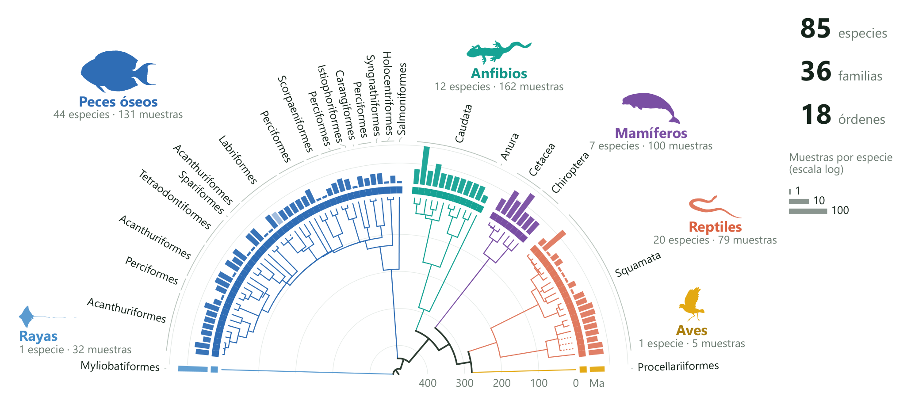
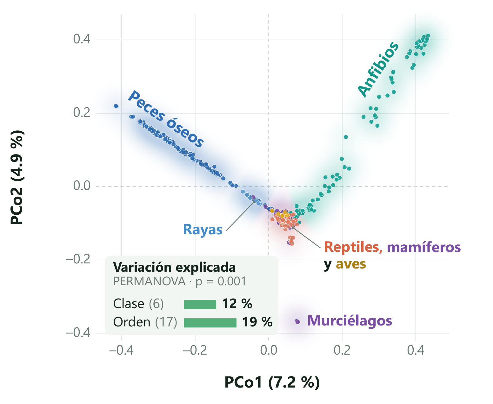
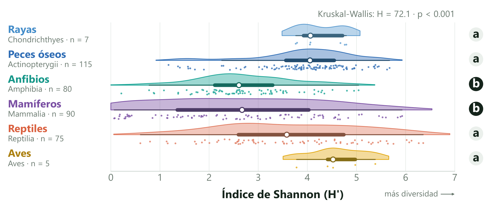
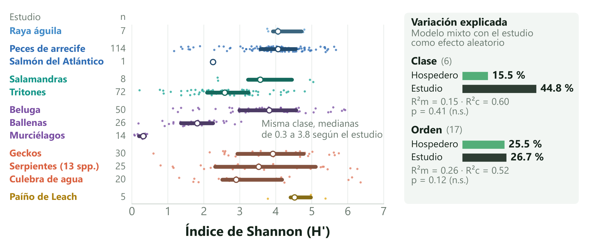

# Patrones de diversidad y composición de la microbiota cutánea en vertebrados

Cartel presentado en el X Congreso Mexicano de Ecología (Puebla, 18 al 23 de octubre de 2026).

J. Alejandro Vázquez-Díaz¹, Enrique Soto-Cortés² y Yanin Islas-Barrios¹\
¹ Laboratorio Divisional de Biología Molecular, UAM-Iztapalapa\
² Centro de Ciencias Genómicas, UNAM

> **En resumen:** el orden del hospedero explica más variación que la clase, pero cada estudio deja su huella.

## El trabajo en breve

**Objetivo:** caracterizar la diversidad y composición de la microbiota cutánea de vertebrados e identificar qué nivel taxonómico del hospedero, clase u orden, explica más variación.

Reunimos datos públicos del gen 16S rRNA (región V4) de la piel de seis clases de vertebrados: rayas, peces óseos, anfibios, mamíferos, reptiles y aves. De 2,640 muestras de 40 estudios conservamos las 509 que compartían región y lecturas pareadas de 2×250 pb, de 13 estudios. Todas pasaron por el mismo procesamiento (cutadapt, DADA2 y clasificación con SILVA 144 en QIIME 2). Después de rarefacer a 5,000 lecturas analizamos 372 muestras de 12 estudios.

## Resultados

### 1. Cobertura filogenética

**Figura 1.** Cronograma de las 85 especies de hospederos (TimeTree). Las barras indican cuántas muestras hay por especie (escala log); las ramas punteadas son especies sin fecha, colocadas en el nodo de su género o familia.

### 2. Composición de la microbiota

**Figura 2.** PCoA de Bray-Curtis (372 muestras). Peces y anfibios forman brazos propios, el resto se agrupa al centro. Cada brazo proviene de un solo estudio.

### 3. Diversidad alfa

**Figura 3.** Índice de Shannon por clase (372 muestras). Letras distintas indican diferencias significativas (Dunn con corrección BH).

### 4. Factores que influyen en la microbiota

**Figura 4.** Shannon por estudio (círculo blanco: mediana) y variación explicada por modelos mixtos con el estudio como efecto aleatorio (R²m: hospedero; R²c: hospedero y estudio).

## Conclusiones

- La composición bacteriana cambia según el hospedero, y el orden explica más variación que la clase (19 % frente a 12 %).
- Anfibios (salamandras y tritones) y mamíferos tienen la microbiota cutánea menos diversa.
- Al considerar el estudio en los modelos mixtos, la clase y el orden dejan de ser significativos, y el estudio llega a explicar 45 % de la variación en la diversidad.
- Cada estudio muestreó una sola clase, así que el efecto del hospedero se confunde con el del estudio. Separarlos requiere muestrear varios grupos con el mismo protocolo.

## Estudios de origen

Las secuencias vienen de NCBI SRA. Gracias a los autores de estos trabajos por hacer públicos sus datos.

| BioProject | Hospederos | Clase | Lugar | Muestras (509 → 372) | Artículo |
|---|---|---|---|---|---|
| [PRJNA712488](https://www.ncbi.nlm.nih.gov/bioproject/PRJNA712488) | Raya águila (*Aetobatus narinari*), silvestres | Rayas | Bahía de Sarasota, Florida, EUA | 32 → 7 | [Clavere-Graciette et al. 2022, *Animal Microbiome*](https://doi.org/10.1186/s42523-022-00187-8) |
| [PRJNA419057](https://www.ncbi.nlm.nih.gov/bioproject/PRJNA419057) | Peces de arrecife (43 especies y peces loro sin identificar) | Peces óseos | Mayotte, océano Índico | 130 → 114 | [Chiarello et al. 2018, *Microbiome*](https://doi.org/10.1186/s40168-018-0530-4) |
| [PRJNA1044012](https://www.ncbi.nlm.nih.gov/bioproject/PRJNA1044012) | Salmón del Atlántico | Peces óseos | Chile | 1 → 1 | [Godoy et al. 2023, *Animals*](https://doi.org/10.3390/ani14010097) |
| [PRJNA368730](https://www.ncbi.nlm.nih.gov/bioproject/PRJNA368730) | Tritones (*Lissotriton boscai*, *Triturus marmoratus*) | Anfibios | Galicia, España | 115 → 72 | [Sabino-Pinto et al. 2017, *Environmental Microbiology*](https://doi.org/10.1111/1462-2920.13762) |
| [PRJNA1002333](https://www.ncbi.nlm.nih.gov/bioproject/PRJNA1002333) | Salamandras (*Eurycea*, *Plethodon*, *Notophthalmus*) | Anfibios | Oklahoma, EUA | 30 → 8 | [Kirsch et al. 2024, *Frontiers in Microbiomes*](https://doi.org/10.3389/frmbi.2024.1277645) |
| [PRJNA320969](https://www.ncbi.nlm.nih.gov/bioproject/PRJNA320969) | Ranas y tritones (4 especies) | Anfibios | Baja Sajonia, Alemania | 17 → 0 | [Bletz et al. 2017, *Royal Society Open Science*](https://doi.org/10.1098/rsos.170107) |
| [PRJNA645381](https://www.ncbi.nlm.nih.gov/bioproject/PRJNA645381) | Beluga | Mamíferos | Alaska, EUA | 50 → 50 | [Van Cise et al. 2020, *Animal Microbiome*](https://doi.org/10.1186/s42523-020-00057-1) |
| [PRJNA428495](https://www.ncbi.nlm.nih.gov/bioproject/PRJNA428495) | Ballenas azul, de aleta y jorobada | Mamíferos | Chile | 35 → 26 | [Toro et al. 2021, *FEMS Microbiology Ecology*](https://doi.org/10.1093/femsec/fiab050) |
| [PRJNA533244](https://www.ncbi.nlm.nih.gov/bioproject/PRJNA533244) | Murciélagos (3 especies) | Mamíferos | 7 estados de EUA | 15 → 14 | [Ange-Stark et al. 2023, *Microbiology Spectrum*](https://doi.org/10.1128/spectrum.02715-23) |
| [PRJNA1151157](https://www.ncbi.nlm.nih.gov/bioproject/PRJNA1151157) | Geckos (7 especies) | Reptiles | Territorio del Norte, Australia | 30 → 30 | [Weitzman et al. 2025, *Environmental Microbiology Reports*](https://doi.org/10.1111/1758-2229.70172) |
| [PRJNA1114659](https://www.ncbi.nlm.nih.gov/bioproject/PRJNA1114659) | Serpientes (13 especies) | Reptiles | EUA | 25 → 25 | [Romer et al. 2025, *Conservation Biology*](https://doi.org/10.1111/cobi.14411) |
| [PRJNA1114724](https://www.ncbi.nlm.nih.gov/bioproject/PRJNA1114724) | Culebra de agua (*Nerodia sipedon*) | Reptiles | No reportado | 24 → 20 | Sin artículo identificado |
| [PRJNA382264](https://www.ncbi.nlm.nih.gov/bioproject/PRJNA382264) | Paíño de Leach | Aves | Isla Bon Portage, Nueva Escocia, Canadá | 5 → 5 | [Pearce et al. 2017, *Microbiome*](https://doi.org/10.1186/s40168-017-0365-4) |

Ninguna muestra de PRJNA320969 llegó a las 5,000 lecturas, así que ese estudio no entra en los análisis.

## Referencias

- Anderson, M. J. (2001). *Austral Ecology*, 26, 32–46.
- Bolyen, E. et al. (2019). *Nature Biotechnology*, 37, 852–857.
- Callahan, B. J. et al. (2016). *Nature Methods*, 13, 581–583.
- Chuvochina, M. et al. (2026). *Nucleic Acids Research*, gkaf1247.
- Kumar, S. et al. (2022). *Molecular Biology and Evolution*, 39, msac174.
- Nakagawa, S. y Schielzeth, H. (2013). *Methods in Ecology and Evolution*, 4, 133–142.
- Ross, A. A. et al. (2019). *Microbiome*, 7, 79.

## Agradecimientos

Los autores agradecen el tiempo de cómputo otorgado por LANCAD y CONAHCyT en la supercomputadora YOLTLA del LSVP de la UAM Iztapalapa.

## Contacto

J. Alejandro Vázquez-Díaz · alejandrofenix19@gmail.com

Más de mi trabajo en bioinformática: [github.com/AlejandroVzD](https://github.com/AlejandroVzD)

## In English

Poster presented at the 10th Mexican Congress of Ecology (Puebla, October 2026). We gathered public 16S rRNA (V4) skin microbiome data from 13 studies across six vertebrate classes and processed them with a single pipeline (cutadapt, DADA2 and SILVA 144 in QIIME 2). After rarefying to 5,000 reads, we analyzed 372 samples from 12 studies. Host order explained more variation in community composition than host class (PERMANOVA R² 19 % vs. 12 %). Amphibians and mammals had the least diverse skin microbiota. With study as a random effect, neither class nor order significantly explained alpha diversity (Shannon index), and study accounted for up to 45 % of its variation. Because each study sampled a single class, host and study effects are confounded. The table above lists the source studies.
